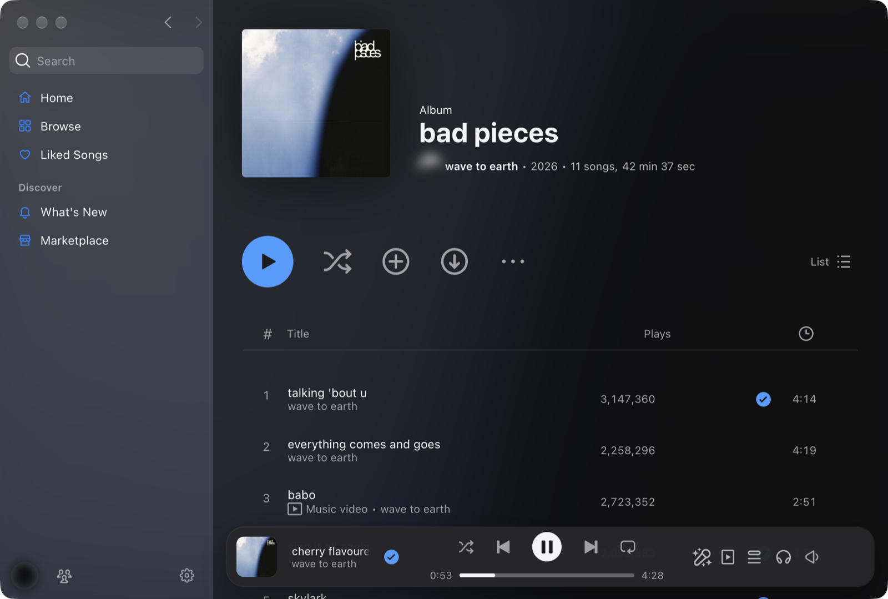
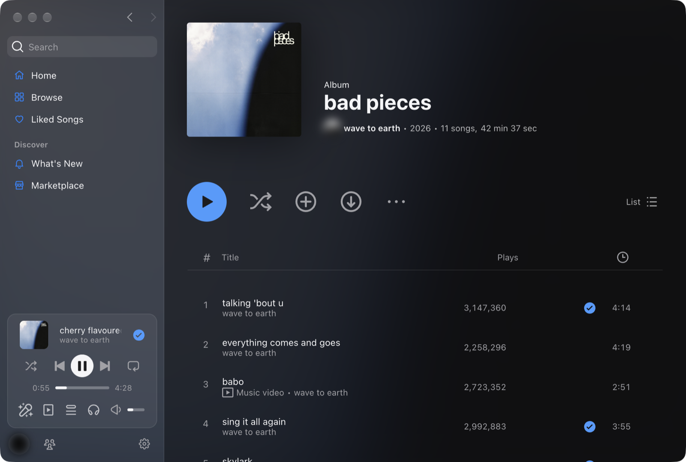
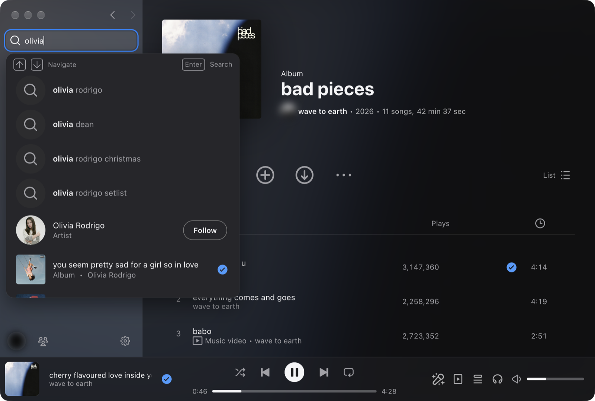
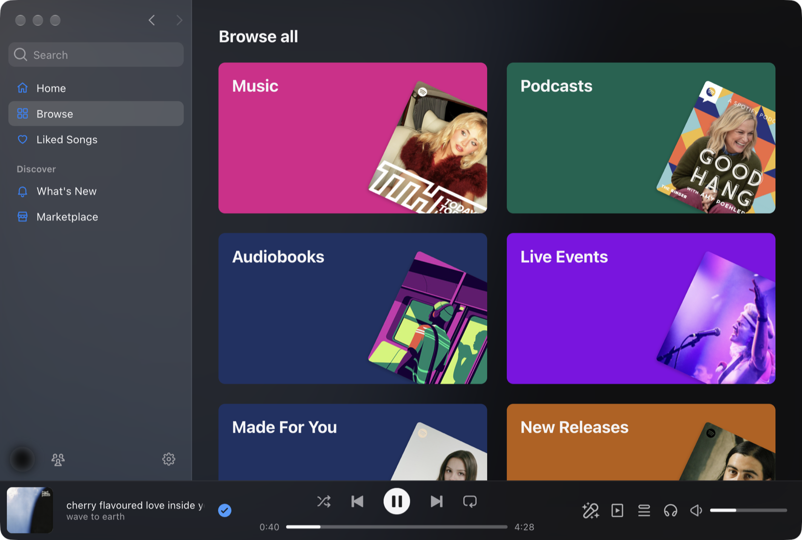

# Spotify Cupertino

Make the Spotify app on your Mac look and feel like a native Mac app, and use less CPU. It runs on top of the official Spotify app, so it works with free and Premium accounts.


## Install

Paste this into Terminal:

```sh
curl -fsSL https://github.com/alextyhwang/spotify-cupertino/releases/latest/download/install.sh | bash
```

It checks your Mac and does whatever is missing: installs Spotify if you don't have it, installs [Spicetify](https://spicetify.app) (the tool that lets Spotify load themes) if you don't have it, then applies the theme. If you already use Spicetify, your other extensions stay. Spotify opens in the background when it's done.

### Using an AI agent?

Give your agent this:

> Install Spotify Cupertino on this Mac by running `curl -fsSL https://github.com/alextyhwang/spotify-cupertino/releases/latest/download/install.sh | bash -s -- --yes`, then verify with `curl -fsSL https://github.com/alextyhwang/spotify-cupertino/releases/latest/download/install.sh | bash -s -- --check` and tell me the result. Ask me before adding `--with-spicy-lyrics`, `--with-marketplace` or `--with-adblock`.

## What you get

- **A Mac sidebar instead of Spotify's top bar.** The window buttons, back and forward, search, Home, Browse, Liked Songs and What's New are in the sidebar. Your account and settings are at the bottom.
- **Mac typography.** Real SF Pro at Apple's sizes, with bold titles instead of Spotify's extra-heavy ones.
- **Liquid Glass window buttons** on macOS 26 and later, placed 20 pt from the top and left like other Mac apps.
- **Your playlists on Home** as a grid, instead of a long sidebar list.
- **Search suggestions** as you type.
- **Lighter.** No animated backgrounds, no looping Canvas videos, and no autoplaying video previews on Home. [spotify-perf](https://github.com/alextyhwang/spotify-perf) stops the player bar from redrawing the whole app every second.
- **Three player styles**, picked from your avatar menu → Player style:

| Bar | Floating | In sidebar |
|---|---|---|
|  |  |  |

| Search suggestions | Browse |
|---|---|
|  |  |

## Options

Add options after `bash -s --`, for example `... | bash -s -- --with-spicy-lyrics`.

| Option | What it does |
|---|---|
| `--yes` | Don't ask questions. |
| `--with-spicy-lyrics` | Adds [Spicy Lyrics](https://github.com/Spikerko/spicy-lyrics) (word-by-word lyrics), downloaded from its own repo. |
| `--with-marketplace` | Adds the [Spicetify Marketplace](https://github.com/spicetify/marketplace) for more themes and extensions. |
| `--with-adblock` | Adds [adblock.js](https://github.com/rxri/spicetify-extensions/tree/main/adblock), downloaded from its own repo. Blocking ads is against Spotify's terms of service, so use it at your own risk. |
| `--block-updates` | Stops Spotify from updating itself. |
| `--no-auto-reapply` | Skips the small helper that re-applies the theme after Spotify updates. |
| `--check` | Prints a status report and exits with an error if something is wrong. |
| `--uninstall` | Removes Spotify Cupertino and restores Spotify's own look, or your previous Spicetify theme. |

Run without `--yes` in a terminal and it will ask about the extras.

## Updates

Spotify updates replace its files, which removes any Spicetify theme. The installer adds a small launch agent that watches for a new Spotify version and re-applies the theme automatically; restart Spotify afterwards to see it. To stay on one version instead, use `--block-updates`.

The layout was tuned on Spotify 1.2.71. On newer versions the theme still applies, but a few spacing details may differ until the next release.

## Manual install

Download `spotify-cupertino.zip` from the [latest release](https://github.com/alextyhwang/spotify-cupertino/releases/latest), unzip it, and run `bash install.sh` inside the folder. To install by hand with Spicetify, copy `theme/` to `~/.config/spicetify/Themes/SpotifyCupertino`, copy `extensions/*.js` to `~/.config/spicetify/Extensions`, then run:

```sh
spicetify config current_theme SpotifyCupertino color_scheme Glass inject_theme_js 1 extensions spotify-perf.js extensions disable-canvas.js
spicetify apply
```

## Credits

The theme started as a customization of [Glassify](https://github.com/sanoojes/spicetify-glassify) and has since been rewritten. Built on [Spicetify](https://github.com/spicetify/cli). Spicy Lyrics, the Marketplace and adblock.js belong to their authors and are downloaded from their repos, not bundled here.

Not affiliated with Spotify or Apple. MIT licensed.
